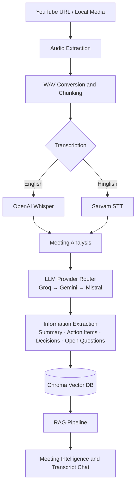

<div align="center">

# VideoRAG

**Turn meeting recordings into searchable, actionable knowledge.**


</div>

VideoRAG is an AI-powered meeting intelligence application that transforms YouTube recordings and local audio/video files into structured, searchable meeting records. It generates transcripts, summaries, action items, key decisions, and open questions, and provides a transcript-grounded chat interface for exploring meeting content.

## Table of Contents

- [Features](#features)
- [Architecture](#architecture)
- [Technology Stack](#technology-stack)
- [Project Structure](#project-structure)
- [Getting Started](#getting-started)
- [Configuration](#configuration)
- [Usage](#usage)
- [Deployment](#deployment)
- [Troubleshooting](#troubleshooting)
- [Testing](#testing)
- [Security and Data Handling](#security-and-data-handling)
- [Limitations](#limitations)
- [Roadmap](#roadmap)

## Features

| Capability | Description |
|---|---|
| **Flexible input** | Process YouTube URLs and local audio/video files. |
| **Multilingual transcription** | English via local OpenAI Whisper; Hinglish via Sarvam STT. |
| **Meeting summarization** | Automatically generate meeting titles and concise summaries. |
| **Action item extraction** | Identify tasks and actionable follow-ups. |
| **Decision extraction** | Surface key decisions and unresolved questions. |
| **Transcript-grounded RAG** | Ask questions about a recording and get answers retrieved from its transcript. |
| **LLM provider failover** | Automatic routing through Groq, Gemini, and Mistral. |
| **Streamlit interface** | Processing progress, structured results, expandable sections, and chat history. |
| **Command-line interface** | Analyze recordings and chat with transcripts directly from the terminal. |

## Architecture



> **Note:** The Chroma vector index is created per meeting session. It is held in memory and is not shared across sessions.

## Technology Stack

| Category | Technologies |
|---|---|
| Language | Python 3.12+ |
| Frontend | Streamlit |
| Dependency management | uv |
| Transcription | OpenAI Whisper, Sarvam STT |
| LLM integration | LiteLLM, Groq, Gemini, Mistral |
| RAG framework | LangChain |
| Vector database | ChromaDB |
| Embeddings | Hugging Face Sentence Transformers |
| Audio processing | FFmpeg, Pydub |
| YouTube processing | yt-dlp, Node.js 22 |
| Deployment | Docker, Render |
| CLI | Python |

## Project Structure

```text
VideoRAG/
├── .github/
│   └── workflows/
│       └── tests.yml          # CI workflow
├── core/
│   ├── transcriber.py         # Whisper and Sarvam transcription
│   ├── summarizer.py          # Title and summary generation
│   ├── extractor.py           # Action items, decisions, open questions
│   ├── llm.py                 # LLM provider routing and failover
│   ├── vector_store.py        # Chroma vector index
│   └── rag_engine.py          # Retrieval-augmented question answering
├── utils/
│   └── audio_processor.py     # Audio extraction, conversion, chunking
├── videorag/
│   └── cli.py                 # Command-line interface
├── app.py                     # Streamlit application
├── main.py
├── Dockerfile
├── packages.txt               # System packages for Streamlit Community Cloud
├── pyproject.toml
├── uv.lock
├── .env.example
└── README.md
```

## Getting Started

### Prerequisites

- **Python 3.12+**
- **[uv](https://docs.astral.sh/uv/)** for dependency management
- **FFmpeg** for audio/video conversion
- **Groq API key** for the primary LLM provider
- **Gemini and/or Mistral API keys** for fallback providers
- **Sarvam API key** for Hinglish transcription

> For YouTube processing, the Docker image bundles Node.js 22, which yt-dlp uses for JavaScript challenge support.

### Installation

**1. Clone the repository**

```bash
git clone https://github.com/iiitianrajan/videoRAG.git
cd videoRAG
```

**2. Create the environment file**

```bash
# macOS / Linux
cp .env.example .env
```

```powershell
# Windows PowerShell
Copy-Item .env.example .env
```

Add your provider credentials to `.env`. Never commit this file to version control.

**3. Install dependencies**

```bash
uv sync --python 3.12
```

**4. Start the application**

```bash
uv run streamlit run app.py
```

Then open [http://localhost:8501](http://localhost:8501).

## Configuration

VideoRAG is configured through environment variables. Copy `.env.example` to `.env` and set the values for the providers you intend to use.

### LLM providers

| Variable | Description | Default |
|---|---|---|
| `GROQ_API_KEY` | Primary LLM provider API key | — |
| `GROQ_MODEL` | Groq model identifier | `groq/openai/gpt-oss-120b` |
| `GEMINI_API_KEY` | Gemini fallback API key | — |
| `GOOGLE_API_KEY` | Backward-compatible Gemini key | — |
| `GEMINI_MODEL` | Gemini model identifier | `gemini/gemini-3.8-flash` |
| `MISTRAL_API_KEY` | Mistral fallback API key | — |
| `MISTRAL_MODEL` | Mistral model identifier | `mistral/mistral-small-latest` |

Only providers with configured credentials are included in the LLM router. The fallback order is:

```text
Groq → Gemini → Mistral
```

If a provider fails or hits a rate limit, LiteLLM attempts the next configured provider.

### Transcription

| Variable | Description | Default |
|---|---|---|
| `WHISPER_MODEL` | Local Whisper model for English | `small` |
| `WISPER_MODEL` | Legacy spelling, accepted for compatibility | — |
| `SARVAM_API_KEY` | Sarvam API key for Hinglish transcription | — |
| `SARVAM_STT_MODEL` | Sarvam STT model | `saaras:v2.5` |

## Usage

### Web interface

1. Provide a YouTube URL or a local media-file path accessible to the application.
2. Select the transcription language:
   - `english` — local OpenAI Whisper
   - `hinglish` — Sarvam STT
3. Click **Analyse** to start the processing pipeline.
4. Follow progress in the Streamlit interface.
5. Review the generated title, summary, action items, key decisions, and open questions.
6. Expand **Full transcript** to inspect the complete transcription.
7. Use the meeting chat to ask questions grounded in the transcript.

Chat history is kept for the duration of the current application session, and the input clears after each response is returned.

### Command-line interface

```bash
uv run videorag
```

The CLI prompts for the input source and transcription language, generates the meeting analysis, and starts an interactive question-answering session. To exit the chat, enter `exit`, `quit`, or `q`.

## Deployment

### Docker

The Docker image provides a consistent runtime with Python 3.12, Node.js 22, FFmpeg, CPU-only PyTorch, and all project dependencies.

```bash
# Build the image
docker build -t videorag .

# Run the container
docker run --rm -p 8501:8501 --env-file .env videorag
```

Then open [http://localhost:8501](http://localhost:8501).

### Render

VideoRAG can be deployed on Render using the included Dockerfile, which supports Render's automatically provided `PORT` environment variable.

1. Push the project to GitHub.
2. Create a new **Web Service** on [Render](https://render.com/).
3. Connect your GitHub repository.
4. Select **Docker** as the runtime.
5. Add your API keys under Render's **Environment** settings.
6. Deploy.

### Streamlit Community Cloud

The included `packages.txt` installs FFmpeg for Streamlit Community Cloud. For this deployment:

- Store credentials using **Streamlit Secrets**.
- Keep `.env` out of version control.
- Remember that local file paths refer to the cloud server, not the visitor's computer.
- Prefer Docker when you need the Node.js runtime for YouTube processing.

> **Important:** Never upload your `.env` file or commit API credentials. Use your deployment platform's secret management.

## Troubleshooting

<details>
<summary><strong>YouTube HTTP 403 or authentication errors</strong></summary>

YouTube may restrict automated downloads and request authentication. The Docker image includes Node.js 22 and yt-dlp EJS support for JavaScript challenges, but this does not guarantee access to every video.

If a download is blocked, use a local audio/video file instead.

</details>

<details>
<summary><strong>FFmpeg not found</strong></summary>

FFmpeg is required for audio extraction and conversion.

- **Windows:** Install FFmpeg and add its executable directory to your system `PATH`.
- **Docker:** Use the included Dockerfile, which installs FFmpeg.
- **Streamlit Community Cloud:** Ensure `packages.txt` contains `ffmpeg`.

</details>

<details>
<summary><strong>Whisper transcription is slow</strong></summary>

English transcription runs locally, and CPU-only inference may take several minutes for longer recordings. Use a smaller model to speed things up:

```env
WHISPER_MODEL=base
```

| Model | Trade-off |
|---|---|
| `tiny` | Fastest, lowest accuracy |
| `base` | Faster, with reasonable accuracy |
| `small` | Better quality, higher resource usage |

</details>

<details>
<summary><strong>Groq HTTP 429 (rate limit)</strong></summary>

A 429 response indicates a provider rate limit. Wait for the retry period reported by Groq. If Gemini and Mistral API keys are configured, LiteLLM will fall back to them automatically.

</details>

<details>
<summary><strong>Gemini fallback errors</strong></summary>

Verify your Gemini API key and the configured model:

```env
GEMINI_MODEL=gemini/gemini-3.8-flash
```

The router drops optional parameters not supported by the selected provider.

</details>

<details>
<summary><strong>Mistral fallback errors</strong></summary>

Verify that `MISTRAL_API_KEY` is valid and has not expired or been revoked.

</details>

<details>
<summary><strong>Missing Python dependencies</strong></summary>

Use the project's uv environment rather than a global Python or Conda installation:

```bash
uv sync --python 3.12
uv run streamlit run app.py
```

</details>

## Testing

Automated tests run through a GitHub Actions workflow, triggered by:

- Pushes to the `main` branch
- Pull requests targeting `main`
- Manual workflow dispatch

Check the repository's **Actions** tab for results.

## Security and Data Handling

- Keep API keys and credentials in environment variables or a secret manager.
- Never commit `.env` files or authentication cookies.
- Rotate any API key accidentally exposed in source code, screenshots, or logs.
- Temporary converted audio and chunks are removed after transcription completes or fails.
- The Chroma index is in-memory and scoped to the current meeting.
- Local file paths refer to the machine running the application.

## Limitations

- YouTube may block automated downloads, even with the appropriate JavaScript runtime.
- Local Whisper transcription is CPU-intensive and may be slow for long recordings.
- The in-memory Chroma index does not persist across sessions.
- Public cloud deployments need sufficient memory, CPU, and storage for media processing.

## Roadmap

- [ ] Persistent vector storage and meeting history
- [ ] Background processing for long recordings
- [ ] Additional transcription providers and languages
- [ ] Improved upload handling for large media files
- [ ] Automated testing across transcription and retrieval components
- [ ] Advanced meeting analytics and insights

---

<div align="center">

**VideoRAG — From meeting recordings to actionable intelligence.**

</div>